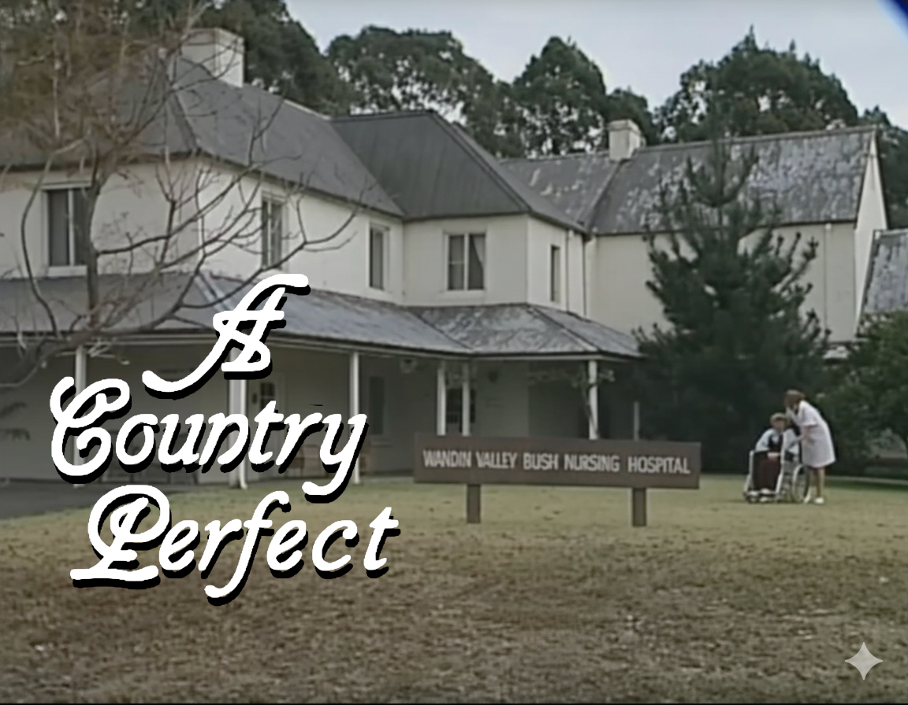

## About *A Country Perfect*
I love watching old episodes of A Country Practice and always want to find out the back-stories and what happened next. For me, the definitive fan page was www.acountrypractice.com which has been offline for many years. I don't know what happened to them but have managed to download the original site from the [web archive](https://archive.org/).

My plan is to collect together the information from those pages and present it using a more modern layout and try to get as much up to date information as I can. Anyone with more stuff is welcome to pass it on - send me a message on the [github page](https://github.com/MarkRand/acountryperfect)

